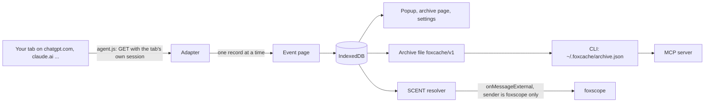
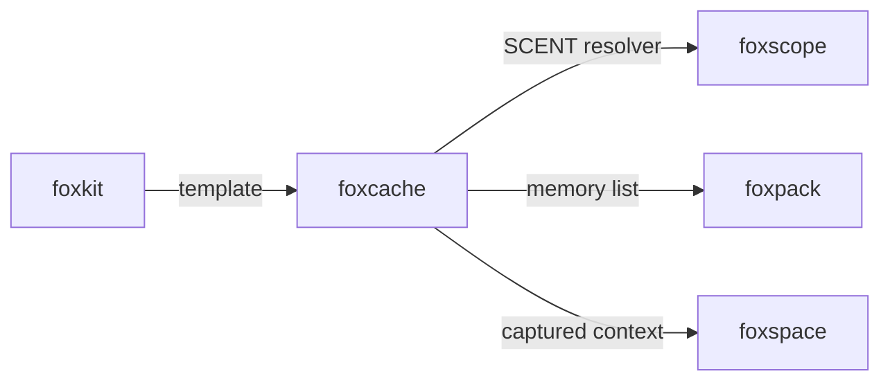

# foxcache

[](https://www.npmjs.com/package/foxcache-ai)
[](https://www.npmjs.com/package/foxcache-ai)
[](https://opensource.org/license/mit)

[Quickstart](#capture-your-first-site) · [Providers](docs/providers/README.md) · [API reference](#runtime-surfaces) · [Coverage](#coverage) · [FAQ](#faq)

foxcache is an open-source Firefox extension, library, CLI and MCP server that copies your own AI chat data into your browser.
It reads your conversations, projects, memories and custom instructions from the AI sites you are signed in to.
Nothing leaves your computer.

## Install

The extension needs Firefox 153 or later. Until it is on addons.mozilla.org, build it and load
`dist-ext/manifest.json` from `about:debugging`:

```bash
pnpm install
pnpm build:ext
```

The npm package is `foxcache-ai`; its command is `foxcache`. It needs Node.js 24 or later and includes TypeScript declarations:

```bash
npm install foxcache-ai
```

It has two runtime dependencies, `@modelcontextprotocol/sdk` and `zod`, for the MCP server.

## Capture your first site

1. Open the foxcache settings (the cog in the toolbar popup) and allow `chatgpt.com`.
2. Open chatgpt.com in a tab and sign in, as you always do.
3. Click the foxcache toolbar button, then **Capture** on the ChatGPT card.
   The card shows the count of conversations, projects and memories as they come in.
   **Stop** ends the capture before its next request; **Resume** goes on from where it
   stopped, and **Start over** leaves the stopped capture behind.
4. Click **Open the archive** to browse and search what foxcache keeps.
   **Archive (JSON)** saves the file that the CLI reads.

From a shell, read that file:

```bash
npx foxcache-ai import ~/Downloads/foxcache-archive-2026-10-15.json
npx foxcache-ai search "lisbon"
npx foxcache-ai export --memories > memories.md
```

## How it works



1. You allow one site at a time. Each site origin is an optional host permission.
2. When you click Capture, foxcache injects `agent.js` into an open tab of that site. The
   agent calls the JSON endpoints that the site's own web app calls, from the same origin,
   so the request carries the session that your tab already has. foxcache never reads a
   password or a cookie.
3. Every request is a GET (`src/http.ts` has nothing else), so foxcache cannot send, edit or
   delete anything on the site. ChatGPT and DeepSeek send a bearer token that their own
   page script reads; foxcache's agent reads it the same way, keeps it in the tab, and
   never stores or passes it on.
4. Requests go one at a time, 1.5 s apart. A 429 waits for `Retry-After` or backs off
   2, 4, 8 ... seconds. A second capture fetches only the conversations that changed;
   it reads the whole list again unless the last capture ended with no error.
5. Each record is checked against the `foxcache/v1` schema and stored without the raw
   provider JSON. Attachments are kept as metadata (name, type, size), never as files.

Each endpoint, its open-source source and a confidence level are in
[docs/providers/](docs/providers/README.md). The design is in [docs/design.md](docs/design.md) and the
failure modes are in [docs/failure-modes.md](docs/failure-modes.md).

## Why it exists

Your AI context is spread over the accounts of each AI company, and each one keeps it in its own format.
The official exports come by email, can take days, and leave out parts: OpenAI says the
[ChatGPT export](https://help.openai.com/en/articles/7260999-how-do-i-export-my-chatgpt-history-and-data)
can take up to 7 days, and its saved memories are kept apart from the chats.
foxcache is step one of a longer flow: capture your data into your own browser first, then
sync it, enforce rules on it and give it to the agents you choose.

## Compare

Checked on 2026-10-15 against the linked pages.

| Item | foxcache | Official exports (ChatGPT, Claude) | [chatgpt-exporter](https://github.com/pionxzh/chatgpt-exporter) |
|---|---|---|---|
| Sites | ChatGPT, Claude, Le Chat, DeepSeek | One each | ChatGPT |
| How you get it | One click, in a minute or so | An email link, up to days later | One click |
| Memories and custom instructions | Yes, where a GET endpoint exists | Claude: `memories.json`; ChatGPT: not reliably | No |
| Kept where | Your browser, then a local file | A zip you download | A file per export |
| A second run | Fetches only what changed | A new full export | A new full export |
| Agents can read it | Through MCP and foxscope, by your rules | No | No |

## Coverage

| Surface | Status | How it is checked |
|---|---|---|
| Library (`foxcache`) | Implemented | 175 vitest tests, written from the failure modes |
| ChatGPT, Claude adapters | Implemented | vitest on synthetic fixtures, and E2E at the real origins |
| Le Chat, DeepSeek adapters | Implemented, conversations only | vitest on synthetic fixtures |
| Gemini, Perplexity, Grok | No adapter: their reads need POST | [docs/providers/](docs/providers/README.md) |
| File store, CLI, MCP server | Implemented | vitest, the MCP server with the SDK in-memory client |
| Firefox extension | Implemented | E2E on Ichabod (remote Firefox 158) and local Firefox, 32 checks |
| SCENT with the real foxscope | Not tested | A stand-in extension with the foxscope id is used |
| Real accounts | Not tested here | `e2e/live-smoke.mjs` runs on your own logins and prints counts only |

The E2E serves synthetic fixtures at `https://chatgpt.com` and `https://claude.ai` with
WebDriver BiDi network interception, so the real origin matching, permission checks and
same-origin fetches run. No real chat is in this repo.

## Runtime surfaces

### Firefox extension

- **Popup**: one card per site: not allowed, no tab open, signed out, ready, or capturing
  with live counts. Capture, Stop, Resume and Start over.
- **Archive page**: browse by site and kind, search titles and messages, read one
  conversation, and export the archive (JSON), Markdown (a zip with one file per
  conversation) or the memory list.
- **Settings**: allow or remove each site, and delete all captured data.
- **SCENT**: `onMessageExternal` answers `{type: "scent.list"}` and
  `{type: "scent.read", fields}` from `foxscope@pooriaarab` only. Any other extension gets
  the error Firefox gives for an extension that is not installed.

| SCENT field | Sensitivity | Value |
|---|---|---|
| `cache.memories` | ask | `[{ provider, text }]` |
| `cache.preferences` | ask | `[{ provider, kind, text }]` |
| `cache.projects` | ask | `[{ provider, name }]`, names only |
| `cache.conversations` | private | never returned |

### Library

| Export | What it does |
|---|---|
| `createStore(backend)`, `memoryBackend()` | The store: `put`, `get`, `all`, `search`, `counts`, `problems`, `deleteAll`. |
| `check(kind, record)` | Check one `foxcache/v1` record; keeps only the named fields. |
| `parseArchive(text)`, `toArchive(store)`, `importArchive(store, text)` | The archive file. An import checks every record before it writes any. |
| `toMarkdown`, `markdownFiles`, `toMemoryList`, `zip` | The exports. Markdown escapes HTML. |
| `createHttp`, `runCapture`, `ADAPTERS` | The GET-only request layer, the polite capture runner and the adapters. |
| `cacheResolver(store)`, `answerScent(resolver, sender, message)` | SCENT v0.1 for the `cache` namespace. |
| `openNodeStore(env)` from `foxcache/node` | Read the file store at `$FOXCACHE_HOME/archive.json`. |
| `updateNodeStore(change, env)` from `foxcache/node` | Change the file store and write it, one writer at a time (`archive.json.lock`). |
| `FoxcacheError` | Has a `code`, such as `logged-out`, `rate-limited`, `provider-schema`, `bad-archive`, `too-large`. |

### CLI

```text
foxcache import <archive>               foxcache list [--provider p] [--kind k]
foxcache search <text> [--provider p] [--kind k] [--limit n]
foxcache show <id>                      foxcache export --json | --memories | --md <dir>
foxcache mcp [--allow conversations]
```

The store is `$FOXCACHE_HOME/archive.json`, by default `~/.foxcache/archive.json`. A directory
foxcache makes is `0700` and the file `0600`. Exit codes: 0 done, 1 a foxcache error, 2 bad usage.

The memory list has one memory per line, for foxpack:

```text
# foxcache memories, exported 2026-10-15T12:00:00.000Z
- [chatgpt] Prefers metric units.
- [claude] Works on a Firefox extension called foxcache.
```

### MCP server

`foxcache mcp` is read-only and serves `list_memories` and `list_preferences` over stdio.
**It serves conversations only when you start it with `--allow conversations`**: then it adds
`search_conversations` and `get_conversation`.

```json
{ "mcpServers": { "foxcache": { "command": "npx", "args": ["-y", "foxcache-ai", "mcp"] } } }
```

## Limits

- Gemini, Perplexity and Grok have no adapter yet: their chat lists or message texts are read
  by POST, and each POST read must be listed and checked by hand first. [docs/providers/](docs/providers/README.md) has the sources.
- Not captured: Claude's topic memory (POST only), ChatGPT's GPTs (no confirmed endpoint),
  Le Chat and DeepSeek projects and memories (no known endpoint), and the contents of any file.
- The endpoints are private web APIs that the sites can change. A changed shape fails
  loudly with `provider-schema`; foxcache does not guess.
- ChatGPT team workspaces: foxcache captures the personal workspace only.
- The capture runs in the site's tab. Keep the tab open; a closed or reloaded tab stops
  the capture, and Resume goes on from there.
- Search is a plain text match over every record. It is fine for thousands of
  conversations, not tuned for hundreds of thousands.
- An archive file and `~/.foxcache/archive.json` hold your chats in plain JSON. Keep them safe.
- The CLI prints what you ask for, conversations too. "private" is about agents, not about
  your own shell.
- In the extension, only the add-on ID `foxscope@pooriaarab` can read through SCENT.
  foxcache trusts that ID and nothing else.

## Part of the fox primitives



## FAQ

### Can foxcache post or delete anything on a site?

No. It can only send the reads its adapter lists (`src/reads.ts`): exact paths, and for a
POST the read operation in the body. The four sites it reads today get GET requests only,
and the E2E checks that every request it sent was one of those reads.

### Does foxcache see my password?

No. It uses the session your tab already has and never reads a password or a login form.
It reads no cookie on the four sites it supports. A bearer token that a site's own page
uses stays inside the tab.

### Can an agent read my chats?

Not by default. The MCP server has conversation tools only with `--allow conversations`,
and SCENT never returns conversations.

## License

[MIT](LICENSE)
